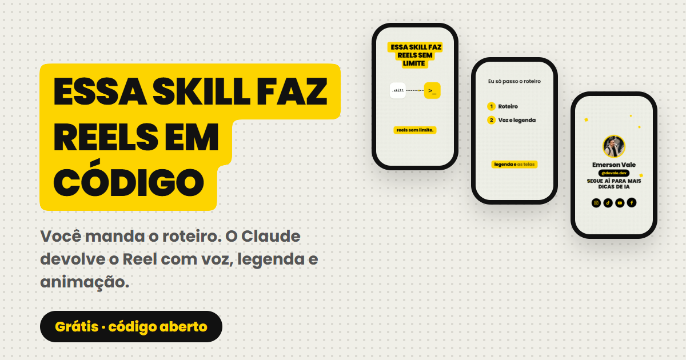
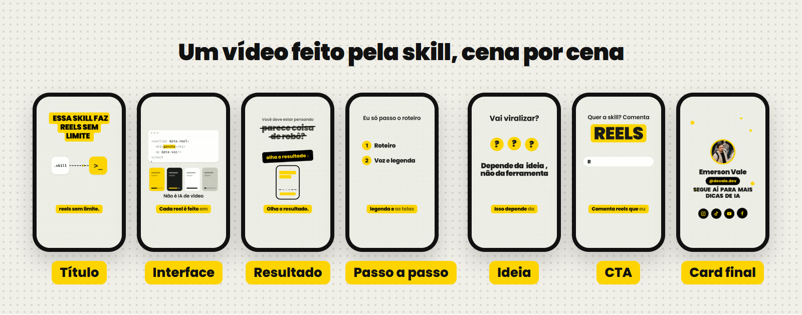
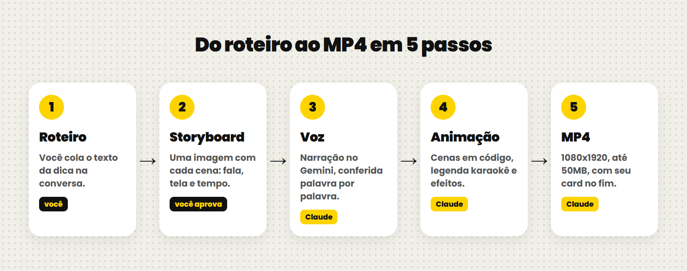

# Reels em código



Duas skills para o Claude que fazem Reels inteiros em código, sem editor de vídeo:

| Skill | O que faz |
|---|---|
| [`reels-video-animado`](skills/reels-video-animado/SKILL.md) | Você passa um roteiro. Ela devolve um Reel animado, sem ninguém gravar: storyboard pra aprovar, narração com Gemini TTS, título amarelo, legenda karaokê, SFX e card final com sua foto e seu @. |
| [`reels-edicao`](skills/reels-edicao/SKILL.md) | Você grava falando pra câmera. Ela corta os silêncios, põe título, legenda karaokê, painéis explicativos animados, zoom e SFX. |

As duas saem em MP4 1080x1920, 30fps, até 50MB, prontas pra Instagram, TikTok, YouTube Shorts e Facebook. A composição é HTML renderizado quadro a quadro num navegador sem janela, com [HyperFrames](https://github.com/heygen-com/hyperframes) e FFmpeg.





Vídeo de exemplo, feito do começo ao fim pela skill: [docs/exemplo.mp4](docs/exemplo.mp4)

## O que precisa

- [Claude Code](https://claude.com/claude-code) (ou o app do Claude com skills ligadas)
- Node 22+ e FFmpeg no PATH
- Python 3.10+ com `numpy` e `playwright`
- Chrome ou Edge instalado (ou `python -m playwright install chromium`)
- Uma chave do Gemini, grátis em [aistudio.google.com/apikey](https://aistudio.google.com/apikey), na variável `GEMINI_API_KEY`

```bash
python -m pip install numpy playwright
```

Windows (PowerShell), pra deixar a chave salva:

```powershell
setx GEMINI_API_KEY "sua-chave-aqui"
```

macOS/Linux: coloque `export GEMINI_API_KEY="sua-chave-aqui"` no seu `~/.zshrc` ou `~/.bashrc`.

## Instalar

**Claude Code:** copie as pastas de `skills/` pra `~/.claude/skills/`.

```bash
git clone https://github.com/emersonsvale/reels-em-codigo.git
cp -r reels-em-codigo/skills/* ~/.claude/skills/
```

No Windows: `Copy-Item -Recurse reels-em-codigo\skills\* $HOME\.claude\skills\`

**App do Claude (claude.ai / desktop):** compacte cada pasta de `skills/` num `.zip` e envie em *Configurações → Capacidades → Skills*. Os scripts precisam de um ambiente com Python e FFmpeg; no app web, o render roda no ambiente de código do Claude.

## Configurar seu perfil

Na pasta `reels-video-animado`, copie `perfil.example.json` para `perfil.json` e preencha:

```json
{
  "nome": "Seu Nome",
  "foto": "foto.jpg",
  "cor_destaque": "#FDD400",
  "cta_final": "SEGUE AÍ PARA MAIS DICAS DE IA",
  "redes": { "instagram": "@seu.perfil", "tiktok": "@seu.perfil", "youtube": "@seucanal", "facebook": "Seu Nome" },
  "handle_no_card": "instagram",
  "pasta_saida": "C:/Videos/Reels",
  "voz": { "modelo": "gemini-3.8-flash-tts", "voz": "Sulafat", "tag": "[upbeat]", "velocidade": 1.12 }
}
```

Coloque sua foto (quadrada, 640px ou mais) ao lado, com o nome que está em `foto`. Só aparecem no card final os ícones das redes que você preencher.

Se você pular esse passo, o Claude pergunta os dados na primeira vez e cria o arquivo. O `perfil.json` e a foto ficam fora do git (`.gitignore`).

## Usar

Fale com o Claude normalmente:

> Faz um vídeo animado com esse roteiro: ...

> Edita esse reels: `C:\Videos\reel-01\gravacao.mp4`, o roteiro está em `roteiro.md`

A skill de vídeo animado sempre manda o storyboard antes de renderizar. Você aprova ou pede ajuste.

Scripts que dá pra rodar sozinho:

```bash
# narração, um WAV por bloco, já conferida por transcrição
python skills/reels-video-animado/scripts/voz_gemini.py falas.json --saida voz/

# card final colado no fim de um vídeo
python skills/reels-video-animado/scripts/render_endcard.py --anexar meu_reel.mp4 --saida final.mp4

# kit mínimo de efeitos (whoosh e pin)
python skills/reels-video-animado/scripts/gerar_sfx.py sfx/
```

Pra ver o card final sem renderizar, abra `skills/reels-video-animado/assets/endcard/endcard.html` no navegador.

## Trocar a voz

Vozes do Gemini que funcionam bem em português: `Sulafat` (padrão), `Kore`, `Puck`, `Charon`. Troque em `perfil.voz.voz`. O estilo vai por tag no começo do texto (`[upbeat]`, `[confident]`); instrução escrita por extenso o modelo lê em voz alta.

## Créditos e licença

- Código e textos: [MIT](LICENSE).
- Fonte Poppins (card final): SIL Open Font License, em `assets/endcard/fonts/OFL.txt`.
- HyperFrames: Apache 2.0, instalado via `npx`, não vem neste repositório.

Feito por [Emerson Vale](https://instagram.com/dovale.dev).
